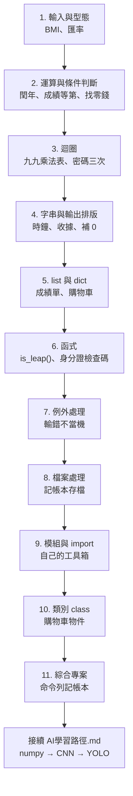

# Python 學習地圖

一次只做一個單元：先自己寫練習、執行、對照預期結果，交給 Claude 檢查後，才進下一個單元。
每個練習都是日常會遇到的小問題，其中「找錯」題是你自己寫程式時真的碰過的錯誤。

## 每個單元怎麼進行

1. 打開單元資料夾，從 `練習說明.md` 開始讀（只有短短的觀念說明）。
2. 依序打開練習檔，把 `# TODO` 的地方寫完。
3. 執行程式，跟檔案最上方的「預期結果」比對。
4. 做完後 commit、push，跟 Claude 說「第 N 單元做完了」。
5. Claude 檢查你的程式、指出問題，再依照你錯的地方產生下一個單元的練習。

> 下一個單元的練習檔，會在你完成目前單元後才建立，題目會依照你在上一個單元的錯誤做調整。

## 單元總覽

| 單元 | 學什麼 | 實際例子 | 你遇過的問題 | 狀態 |
|---|---|---|---|---|
| 1. 輸入與型態 | `input()` 永遠是字串、`int()`／`float()` 轉換、`round()` | BMI 計算、台幣換美元 | `years % 4` 出現 `TypeError` | ⬜ 進行中 |
| 2. 運算與條件判斷 | `%`、`//`、`and`／`or`、`==`／`!=`、`if/elif/else` 的順序 | 閏年、成績等第、找零錢 | 閏年條件寫成 `% 100 == 0` | ⬜ |
| 3. 迴圈 | `range(start, stop)` 不包含 stop、巢狀迴圈、`break`／`continue` | 九九乘法表（三角形／方陣）、密碼只能錯三次、1～100 偶數總和 | 內層 `range(1, c + 1)` 只印出一半 | ⬜ |
| 4. 字串與輸出排版 | f-string 格式 `:02d`、`:<6`、`:>8`、`:.2f` | 秒數轉 `01:02:05`、收據對齊 | 1～9 要補 0 | ⬜ |
| 5. list 與 dict | 新增、刪除、走訪、`len`／`sum`／`max` | 全班成績統計、購物車結帳 | | ⬜ |
| 6. 函式 | `def`、參數、`return` 和 `print` 的差別 | `is_leap(year)`、身分證字號檢查碼驗證 | | ⬜ |
| 7. 例外處理 | `try`／`except`／`else`、`while True` 重問直到輸入正確 | 輸入 `abc` 不當機 | `if fp != None` 檢查不到開檔失敗 | ⬜ |
| 8. 檔案處理 | 相對路徑看的是終端機位置、`Path(__file__).parent`、`encoding="utf-8"`、`w`／`a`／`r`、`with` | 記帳本寫入與讀取加總 | 寫到最外層的 `note.txt`、中文變亂碼 | ⬜ |
| 9. 模組與 import | `import` 會執行整個檔案、`if __name__ == "__main__":`、檔名不要跟內建模組撞名 | 把閏年、身分證檢查放進自己的工具模組 | `pwd.py` 跳出輸入密碼 | ⬜ |
| 10. 類別 class | `__init__`、`self`、方法 | 購物車類別（加入、移除、結帳） | | ⬜ |
| 11. 綜合專案 | 把 1～10 串起來 | 命令列記帳本：新增、列出、月統計、存檔 | | ⬜ |

完成第 11 單元之後，接著做 repo 裡的 [`AI學習路徑.md`](../AI學習路徑.md)（numpy → matplotlib → CNN → YOLO）。

## 命名規則（避免第 9 單元的問題提早發生）

- 練習檔用中文或加編號命名，例如 `1-2_BMI計算.py`。
- 不要把檔案取名成 `pwd.py`、`random.py`、`math.py`、`time.py`、`test.py`、`json.py`、`string.py` 這類 Python 內建模組的名稱。
